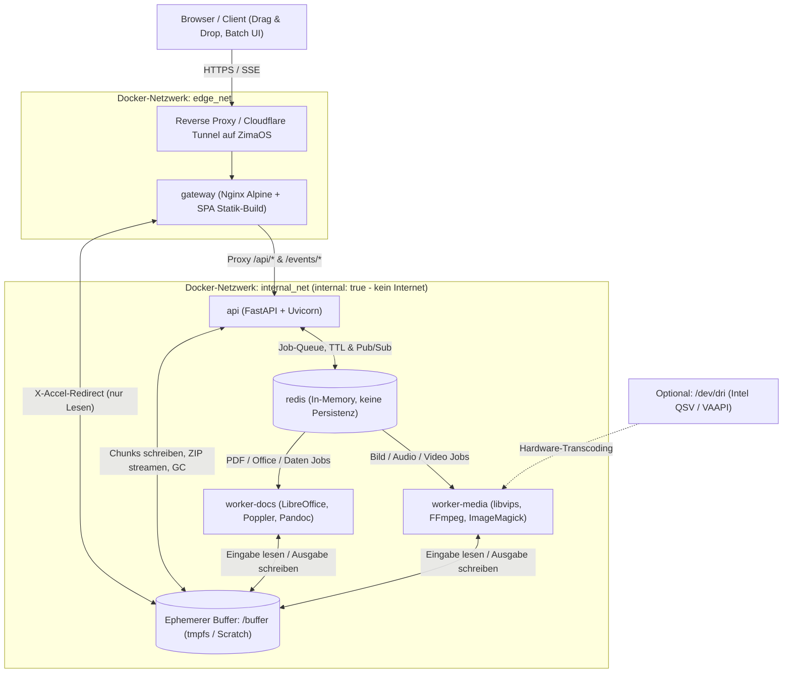
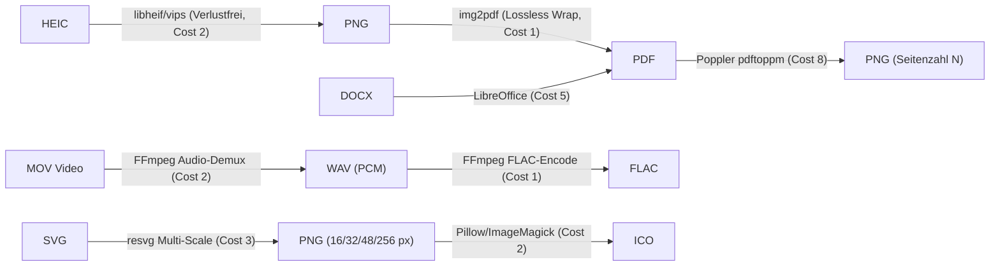
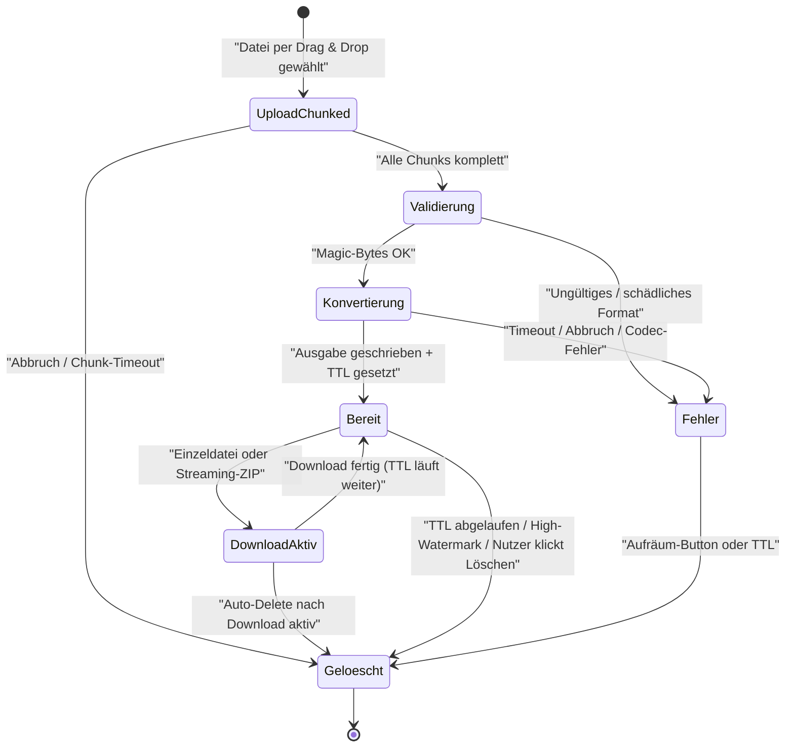

# Architektur- und Umsetzungsplan: Ephemerer Online-Dateikonverter für Portainer auf ZimaOS

> **Kurzfassung:** Vollständige technische und gestalterische Spezifikation für einen selbstgehosteten, mandantenlosen Online-Universalkonverter (Bilder, Audio, Video, PDF, Office, E-Books und strukturierte Daten). Betrieben als gehärteter Multi-Container-Stack in **Portainer auf ZimaOS**, ohne dauerhafte Datenspeicherung (*Zero-Persistence*) und gestaltet nach **DIN EN ISO 9241 (Teile 11, 110, 171)** sowie den **Apple Human Interface Guidelines (HIG)**.

---

## Inhaltsverzeichnis

1. [Projektvision, Leitprinzipien & Rahmenbedingungen](#1-projektvision-leitprinzipien--rahmenbedingungen)
2. [Systemarchitektur (Multi-Container-Stack für Portainer auf ZimaOS)](#2-systemarchitektur-multi-container-stack-für-portainer-auf-zimaos)
3. [Unterstützte Dateiformate & Graph-basierte Konvertierungs-Engine](#3-unterstützte-dateiformate--graph-basierte-konvertierungs-engine)
4. [Ephemerer Buffer, Streaming & Speicher-Management (Zero-Persistence)](#4-ephemerer-buffer-streaming--speicher-management-zero-persistence)
5. [UI/UX-Design-Spezifikation: DIN EN ISO 9241 & Apple HIG](#5-uiux-design-spezifikation-din-en-iso-9241--apple-hig)
6. [API-Design, Chunked Uploads & Echtzeit-Kommunikation](#6-api-design-chunked-uploads--echtzeit-kommunikation)
7. [Sicherheitskonzept für den Online-Betrieb](#7-sicherheitskonzept-für-den-online-betrieb)
8. [Deployment in Portainer auf ZimaOS](#8-deployment-in-portainer-auf-zimaos)
9. [Projektstruktur (Monorepo) & Technologie-Entscheidungen (ADRs)](#9-projektstruktur-monorepo--technologie-entscheidungen-adrs)
10. [Gestaffelter Umsetzungsplan (Roadmap & Abnahmekriterien)](#10-gestaffelter-umsetzungsplan-roadmap--abnahmekriterien)

---

## 1. Projektvision, Leitprinzipien & Rahmenbedingungen

### 1.1 Zielbild
Aufbau einer schnellen, datensparsamen und visuell ruhigen Web-Applikation, die über einen öffentlichen oder privaten Zugang (z. B. via Cloudflare Tunnel oder Reverse Proxy auf **ZimaOS**) erreichbar ist und Dateien nahezu beliebiger Mediengattungen untereinander konvertiert. Nutzer ziehen eine oder mehrere Dateien per Drag & Drop in das Browserfenster, wählen pro Datei oder für den gesamten Stapel (*Batch*) ein Zielformat, verfolgen den Fortschritt in Echtzeit und laden die Ergebnisse einzeln oder als gestreamtes ZIP-Archiv herunter.

### 1.2 Vier verbindliche Leitprinzipien

| Prinzip | Konkrete Ausprägung im System |
| :--- | :--- |
| **Zero-Persistence / Ephemeral by Design** | Keine Benutzerkonten, keine relationale Datenbank, kein dauerhafter Dateispeicher. Hochgeladene und konvertierte Dateien liegen ausschließlich kurzzeitig in einem RAM-basierten `tmpfs` (oder einem streng begrenzten Scratch-Verzeichnis) und werden nach kurzer TTL (Standard: 15–30 Minuten), nach erfolgreichem Download (optional) oder per Sofort-Lösch-Button rückstandslos entfernt. |
| **Security First** | Dateiparser sind klassische Angriffsziele. Alle Konvertierungs-Worker laufen als unprivilegierte Non-Root-Prozesse in einem Docker-Netzwerk **ohne Internetzugang (`internal: true`)**, mit Read-Only-Root-Filesystem, harter Magic-Byte-Prüfung, deaktivierten gefährlichen Codern (z. B. ImageMagick `MVG`/`URL`) und strikten Speicher- sowie Zeitlimits. |
| **Ergonomie & Ästhetik** | Die Weboberfläche verbindet die messbare Gebrauchstauglichkeit und Barrierefreiheit der **DIN EN ISO 9241 (Teile 11, 110, 171)** mit der visuellen Klarheit, Materialität und direkten Manipulation der **Apple Human Interface Guidelines (HIG)**. |
| **ZimaOS-Hardware-Optimierung** | Durch `tmpfs`-Buffering entstehen null SSD/NVMe-Abnutzungszyklen bei Standardkonvertierungen. CPU- und RAM-Quotas schützen parallel laufende ZimaOS-Dienste (z. B. NAS-Freigaben, Jellyfin). Auf Intel-basierten ZimaBoards / ZimaCubes (z. B. Intel N100 oder Core i5) kann optional `/dev/dri` für Intel QuickSync (QSV/VAAPI) durchgereicht werden. |

---

## 2. Systemarchitektur (Multi-Container-Stack für Portainer auf ZimaOS)

### 2.1 Netzwerk- und Container-Topologie

Das System trennt strikt zwischen dem exponierten Edge-Gateway und den isolierten Verarbeitungs-Workern. Die Worker haben keinerlei ausgehenden Netzwerkzugriff – manipulierte Dokumente (z. B. HTML, SVG, M3U8-Playlists oder DOCX mit externen Tracking-Pixeln/Entities) können keine Verbindungen ins LAN oder Internet aufbauen (SSRF-Prävention).



### 2.2 Container-Komponenten und Begründung der Stack-Wahl

1. **`gateway` (Nginx Alpine mit integriertem SPA-Build)**
   - **Aufgabe:** Liefert das gebaute Frontend aus, übernimmt TLS-Header/Security-Header, Rate-Limiting pro IP, leitet `/api/*`- und SSE-Verbindungen (`/events/*`) ohne Pufferung an `api` weiter und liefert fertige Downloads speicherschonend per `X-Accel-Redirect` direkt aus `/buffer` aus (Zero-Copy im Python-Prozess).
   - **Warum Nginx statt zusätzlichem Node-Server?** Ein statischer Build benötigt zur Laufzeit keinen Node.js-Prozess, verbraucht unter 20 MB RAM und eliminiert SSR-Angriffsflächen.

2. **`frontend` (Build-Stage: React 19 + TypeScript + Vite + Tailwind CSS v4 + Radix UI)**
   - **Aufgabe:** Responsives 1-Screen-Interface nach Apple HIG und DIN EN ISO 9241.
   - **Warum Radix UI / Base UI?** Liefert WAI-ARIA-konforme Fokus-Fallen, Tastaturnavigation und Screenreader-Attribute für Popovers, Dialoge und Dropdowns ab Werk (entscheidend für ISO 9241-171 / WCAG 2.2 AA).

3. **`api` (Python 3.12+ / FastAPI / Uvicorn)**
   - **Aufgabe:** Erzeugt anonyme Ephemeral-Batches (`batch_token`), nimmt Chunked Uploads entgegen, prüft Dateiformate anhand von Magic-Bytes (`python-magic`), berechnet die optimale Konvertierungspipeline per Conversion-Graph, steuert Redis-Queues (ARQ), streamt Fortschritte per Server-Sent Events (SSE), erzeugt Multi-File-Downloads als on-the-fly **Streaming-ZIP** (`zipstream-ng`) und betreibt den Garbage Collector.

4. **`redis` (Redis 7 Alpine, `--save "" --appendonly no`)**
   - **Aufgabe:** Reiner In-Memory-Broker für asynchrone Job-Queues, Live-Fortschritts-Events (Pub/Sub) und kurzlebige Job-Metadaten mit automatischer Redis-TTL. Persistenz (`RDB`/`AOF`) ist explizit abgeschaltet.

5. **`worker-media` (Medien-Worker)**
   - **Werkzeuge:** `libvips` (`pyvips`) als primäre Streaming-Bild-Engine (extrem geringer RAM-Bedarf bei großen Bildern), `FFmpeg` (inkl. optionaler Intel VAAPI/QSV-Unterstützung), `ImageMagick` (streng gehärtete `policy.xml` als Fallback für Exotenformate/PSD), `libheif`, `libjxl`, `libraw`, `resvg`/`librsvg` und `img2pdf`.

6. **`worker-docs` (Dokumenten- & Daten-Worker)**
   - **Werkzeuge:** `LibreOffice Headless` (alternativ oder ergänzend anbindbar über ein isoliertes **Gotenberg**-Sidecar zur noch robusteren `soffice`-Prozessüberwachung), `Poppler` (`pdftoppm`, `pdfinfo`), `Ghostscript`, `qpdf`, `Pandoc`, Python-Datenbibliotheken (`openpyxl`, `PyYAML`, `lxml`, `csv`). Optional per Docker-Compose-Profil `ebooks`: `Calibre` (`ebook-convert`) für EPUB/MOBI/AZW3, da Calibre ca. 800 MB Image-Größe mitbringt.

### 2.3 Warum zwei spezialisierte Worker statt eines Monolithen?
- **Fehlertoleranz & Isolation:** Hängende LibreOffice-Prozesse bei kaputten DOCX-Dateien blockieren keine schnellen 200-ms-Bildkonvertierungen.
- **Image-Größe & Wartbarkeit:** Media-Codecs (FFmpeg/libvips) und Office/PDF-Stacks (LibreOffice/Java-Anteil/Fonts) besitzen völlig unterschiedliche Abhängigkeitsbäume.
- **Gezielte Ressourcen-Quotas:** `worker-media` benötigt hohe CPU-Kerne für Video-Encoding; `worker-docs` profitiert von sauber gekapselten Einzelsessions mit strengen Prozess-Timeouts.

---

## 3. Unterstützte Dateiformate & Graph-basierte Konvertierungs-Engine

### 3.1 Vollständige Format-Matrix

| Kategorie | Eingabeformate | Ausgabeformate | Primär-Engine(s) | Besonderheiten & Hinweise |
| :--- | :--- | :--- | :--- | :--- |
| **Rasterbilder** | PNG, JPG/JPEG, WebP, AVIF, HEIC/HEIF, JXL, TIFF, BMP, GIF (statisch/animiert), ICO, TGA | PNG, JPG/JPEG, WebP, AVIF, HEIC, JXL, TIFF, BMP, GIF, ICO, PDF | `libvips` (`pyvips`), `libheif`, `libjxl`, `img2pdf`, `ImageMagick` | Automatische EXIF-Orientierung; Alpha-Erhalt bzw. konfigurierbare Hintergrundfarbe bei Ziel JPG/BMP; Multi-Size-ICO (`16, 32, 48, 256 px`). |
| **Vektor & Spezialbilder** | SVG, PSD (Lesen), Kamera-RAW (CR2, NEF, ARW, DNG, ORF) | PNG, JPG, WebP, AVIF, TIFF, PDF | `resvg`/`librsvg`, `libraw` + `libvips`, `ImageMagick` | SVG-Rasterisierung mit wählbarer DPI; RAW-Demosaicing ohne Verlust von 16-Bit-Tonwerten vor Zielkonvertierung. |
| **Audio** | MP3, WAV, FLAC, AAC, M4A, OGG (Vorbis), OPUS, WMA, AIFF, ALAC, AC3, AMR, WebM-Audio | MP3, WAV, FLAC, AAC/M4A, OGG, OPUS, AIFF, ALAC | `FFmpeg` | Bitrate, Sample-Rate, Mono/Stereo und optionale EBU-R128-Lautheitsnormalisierung. |
| **Video & Video-zu-Audio** | MP4, MKV, WebM, MOV, AVI, WMV, FLV, MPEG, TS, 3GP, animiertes GIF | MP4 (H.264/H.265/AV1), MKV, WebM (VP9/AV1), MOV, AVI, animiertes GIF, **MP3/WAV/FLAC/AAC/OPUS** | `FFmpeg` (CPU oder QSV/VAAPI) | Direkte Audio-Extraktion aus Videos; GIF mit optimierter 2-Pass-Farbpalette (`palettegen` / `paletteuse`); optionales Stummschalten. |
| **PDF & Office-Dokumente** | PDF, DOCX, DOC, ODT, RTF, TXT, XLSX, XLS, ODS, CSV, PPTX, PPT, ODP | PDF (Standard / PDF/A / komprimiert), DOCX, ODT, RTF, TXT, XLSX, ODS, CSV, HTML, **PNG/JPG/WebP/TIFF** | `LibreOffice`, `Poppler`, `Ghostscript`, `qpdf` | Mehrseitige PDF -> Bilder ergibt automatisch ein ZIP-Archiv mit seitennummerierten Dateien; mehrere Bilder -> kombiniertes PDF via `img2pdf`. |
| **Markup & E-Books** | Markdown (MD), HTML, EPUB, MOBI*, AZW3* | PDF, DOCX, ODT, HTML, MD, TXT, EPUB, MOBI*, AZW3* | `Pandoc`, `LibreOffice`, optional `Calibre` (*) | (*) MOBI/AZW3 über optionales `ebooks`-Profil; HTML-Inputs strikt ohne Nachladen externer Ressourcen gerendert. |
| **Strukturierte Daten** | JSON, YAML, XML, CSV, XLSX | JSON, YAML, XML, CSV, XLSX | Python (`PyYAML`, `lxml`, `openpyxl`, `csv`) | Leichtgewichtige Konvertierung im Sekundenbruchteil; flache Tabellen-zu-Objekt-Abbildung mit klarer Fehlermeldung bei nicht-tabellarischen Strukturen. |

### 3.2 Graph-basierte Konvertierungs-Engine (Directed Weighted Graph)

Statt Hunderter starrer `if/elif`-Regeln verwaltet das Backend alle Konvertierungsmöglichkeiten als **gerichteten, gewichteten Graphen**. Jeder Knoten ist ein kanonisches Format; jede Kante definiert:

```text
Edge(
    src_format, dst_format,
    engine,               # z. B. "libvips", "ffmpeg", "libreoffice", "poppler", "img2pdf"
    cost_quality,         # Verlustmaß (0 = verlustfrei, 10 = moderat, 30 = Rasterisierung)
    cost_time,            # Geschätzte Ausführungszeit
    preserves_alpha,      # bool
    preserves_multipage   # bool
)
```

Ein **Dijkstra-Shortest-Path-Router** ermittelt für jedes Paar `(Quelle -> Ziel)` automatisch den qualitativ besten und schnellsten direkten Weg – oder bei Bedarf eine **Multi-Hop-Pipeline** über verlustfreie Zwischenformate (z. B. `PNG`, `WAV`, `PDF`).



### 3.3 Multi-Output- & Multi-Input-Intelligenz

- **1-zu-N-Ausgaben (z. B. 12-seitiges PDF -> PNG):** Erzeugt ein Konvertierungsjob mehrere Ausgabedateien, werden diese automatisch gebündelt, im UI mit der Seiten-/Dateianzahl ausgewiesen (z. B. `12 Seiten • ZIP`) und nahtlos heruntergeladen.
- **N-zu-1-Modus (Bilder zu einem PDF kombinieren):** Lädt der Nutzer mehrere Bilder hoch, erscheint in der Batch-Steuerleiste ein optionaler Schalter *„Alle Bilder zu einem PDF zusammenführen“*. Die Reihenfolge lässt sich per Drag & Drop (oder Pfeiltasten für Tastaturnutzer) festlegen; `img2pdf` bettet die Bilder verlustfrei (ohne unnötiges Re-Encoding bei JPEG) in eine geordnete PDF-Datei ein.

### 3.4 Konvertierungs-Presets & Erweiterte Optionen (Progressive Disclosure)

Alle Optionen sind standardmäßig eingeklappt und mit sinnvollen Defaults vorbelegt, um Einsteiger nicht zu überfordern:

- **Bilder:** Qualität (`1–100`, Default `85` für JPG/WebP, `75` für AVIF), Skalierung (Original / Max. Kantenlänge mit Seitenverhältnis), SVG/PDF-Auflösung (`72 / 150 / 300 DPI`), **Metadaten/EXIF entfernen** (Datenschutz-Toggle, Standard: optional konfigurierbar), Hintergrundfarbe bei Alpha-Verlust (`#FFFFFF` / `#000000` / benutzerdefiniert).
- **Audio:** Bitrate (`128 / 192 / 256 / 320 kbps`), Sample-Rate (`Original / 44.1 kHz / 48 kHz`), Kanäle (`Original / Stereo / Mono`), Lautheitsnormalisierung (`EBU R128`).
- **Video:** Qualitäts-Preset (`Klein / Ausgewogen / Hoch` über CRF-Werte), Zielauflösung (`Original / 1080p / 720p / 480p`), Video-Codec (`H.264 / H.265 / VP9 / AV1`), Audio entfernen (*Mute*), Hardware-Beschleunigung nutzen (automatisch aktiviert, falls `/dev/dri` verfügbar).
- **Dokumente & PDF:** Seitenbereich (z. B. `1-5, 8`), PDF-Komprimierungsstufe (`Bildschirm 72 dpi / E-Book 150 dpi / Druck 300 dpi`), Ziel-DPI beim PDF-zu-Bild-Export.

---

## 4. Ephemerer Buffer, Streaming & Speicher-Management (Zero-Persistence)

### 4.1 Zwei-Stufen-Buffer-Strategie für ZimaOS

Da auf der Website nichts dauerhaft gespeichert werden soll, übernimmt `/buffer` als geteilter Docker-Mount zwischen `api`, `gateway`, `worker-media` und `worker-docs` die Rolle des kurzlebigen Zwischenspeichers:

- **Modus A – `tmpfs` (RAM-Disk, Standardempfehlung für Bilder, Audio, Dokumente):**
  - Konfiguriert mit `size=2G` bis `4G` (abhängig vom verfügbaren ZimaOS-RAM, z. B. 8–16 GB).
  - Vorteile: Maximale I/O-Geschwindigkeit, null Verschleiß auf ZimaOS-SSDs/NVMe, vollständige automatische Löschung bei Container-Neustart oder Stromverlust.
- **Modus B – Dediziertes Scratch-Volume / Hybrid (für große Video-Batches):**
  - Optionales separates Host-Verzeichnis (z. B. `/DATA/AppData/converter-scratch`), falls regelmäßig Videos > 1–2 GB konvertiert werden. Streng getrennt von produktiven NAS-Daten, identisch überwacht durch TTL-Garbage-Collector und High-Watermark-Schutz.

### 4.2 Lebenszyklus einer Datei



### 4.3 Speicher-Schutz, Cleanup & Streaming-Downloads

1. **Periodischer Garbage Collector (alle 60 Sekunden):**
   - Entfernt abgelaufene Batch-Verzeichnisse (`/buffer/batches/{batch_id}`), abgebrochene Upload-Chunk-Ordner (`/buffer/uploads/{upload_id}` älter als 30 Min.) und verwaiste Temporärdateien.
2. **High-Watermark & LRU-Eviction:**
   - Überwacht die Auslastung von `/buffer`:
     - **Ab 80 % Belegung:** Älteste bereits heruntergeladene oder abgeschlossene Batches werden vorzeitig aus `/buffer` und Redis gelöscht (*LRU-Eviction*).
     - **Ab 90 % Belegung:** Die Upload-Annahme liefert `HTTP 507 Insufficient Storage` mit `Retry-After`-Header; das Frontend zeigt einen verständlichen Hinweis statt eines kryptischen Abbruchs.
3. **Sofort-Löschung & Tab-Close-Cleanup:**
   - Ein prominenter Button **„Alle Dateien jetzt löschen“** ruft `DELETE /api/v1/batches/{batch_id}` auf und entfernt Eingabe- und Ausgabedateien sofort.
   - Ein optionaler Toggle **„Nach Download sofort vom Server entfernen“** triggert die Löschung unmittelbar nach Abschluss des Dateistreams.
   - Beim Schließen des Browser-Tabs sendet `navigator.sendBeacon('/api/v1/batches/{batch_id}/dispose')` optional ein Aufräumsignal, sofern keine Konvertierung mehr im Hintergrund aktiv gehalten werden soll.
4. **On-the-fly Streaming-ZIP (`zipstream-ng`):**
   - Bei *„Alle als ZIP laden“* wird keine zweite temporäre `.zip`-Datei auf `/buffer` geschrieben. Die Einzeldateien werden direkt aus `/buffer` als ZIP-Stream in die HTTP-Response geleitet (mit `ZIP_STORED` für bereits komprimierte Formate wie JPG/MP4/PNG, um CPU auf ZimaOS zu sparen).
5. **Zugriffsschutz ohne Benutzerkonto:**
   - Jeder Batch erhält bei Erstellung ein kryptographisch zufälliges 256-Bit-`batch_token`, das ausschließlich im Browser (`sessionStorage` bzw. als `HttpOnly; SameSite=Strict`-Session-Cookie) gehalten wird. Fremde Nutzer können Job- oder Batch-IDs nicht erraten oder abrufen.

---

## 5. UI/UX-Design-Spezifikation: DIN EN ISO 9241 & Apple HIG

Die Gestaltung verbindet zwei komplementäre Qualitätsstandards: **DIN EN ISO 9241** sichert ergonomische Effizienz, Fehlerfreiheit und Barrierefreiheit; **Apple HIG** liefert visuelle Ruhe, direkte Manipulation und spürbare Präzision.

### 5.1 Konkrete Umsetzung der DIN EN ISO 9241

#### Teil 110:2020 – Die 7 Interaktionsprinzipien

| ISO 9241-110 Prinzip | Konkrete Umsetzung in der Weboberfläche |
| :--- | :--- |
| **1. Aufgabenangemessenheit** | Fokussierter 1-Screen-Workflow (*Drop → Zielformat → Konvertieren → Download*). Kein Marketing-Ballast, keine unnötigen Zwischenschritte. Intelligente Standard-Zielformate je Quelltyp (z. B. HEIC → JPG/PNG, WAV → MP3, DOCX → PDF). Erweiterte Parameter standardmäßig eingeklappt. |
| **2. Selbstbeschreibungsfähigkeit** | Jede Dateikarte zeigt eindeutig: erkannten Dateityp (aus Magic-Bytes, nicht nur Dateiname), Dateigröße, aktuelle Phase (*„Lädt hoch 42 %“* → *„Konvertiert 78 %“* → *„Fertig • 1,2 MB (-64 %)“*), den verbleibenden Lösch-Countdown (`Verfällt in 14:32`) und klare Status-Icons. |
| **3. Erwartungskonformität** | Etablierte Desktop- und Web-Konventionen: Drag & Drop über das gesamte Browserfenster, `Strg+V` / `Cmd+V` zum Einfügen aus der Zwischenablage, `Esc` schließt offene Popovers/Modals, einheitliche Position von Primäraktionen (rechts/unten) und destruktiven Aktionen (rot markiert, mit Bestätigung bei Batch-Löschung). |
| **4. Lernförderlichkeit** | Selbsterklärender Einstieg ohne Handbuch. Der Format-Picker gruppiert Zielformate nach Kategorien (*Bilder, Audio, Video, Dokumente*) und bietet ein Echtzeit-Suchfeld (z. B. Eingabe „webp“ oder „kleiner“) mit kurzen Hinweisen wie *„ideal fürs Web“* oder *„verlustfrei“*. |
| **5. Steuerbarkeit** | Volle Kontrolle auf Batch- und Einzeldatei-Ebene: Einzelne Dateien entfernen, laufende Jobs einzeln abbrechen, Zielformat für ausgewählte Dateien individuell überschreiben, fehlgeschlagene Dateien einzeln neu starten – ohne den laufenden Batch zu unterbrechen. |
| **6. Fehlertoleranz** | Frühzeitige Validierung (Dateigröße/Leerdatei bereits vor Upload-Start im Browser, Magic-Byte-Prüfung vor Queueing). Isolierte Fehler pro Datei (eine defekte PDF stoppt nie die übrigen 9 Dateien). Verständliche Fehlermeldungen mit Handlungsoption (z. B. *„Dieses PDF ist passwortgeschützt und kann nicht entsperrt werden“*). **Undo-Toast** (5 Sek.) beim versehentlichen Entfernen einer Datei aus der Liste. |
| **7. Benutzerbindung / Individualisierbarkeit** | Automatische Übernahme des System-Farbschemas (Light/Dark) mit manuellem Umschalter. Zuletzt gewählte Zielformate, Standard-Presets (z. B. *EXIF-Daten immer entfernen* oder *Nach Download löschen*) werden lokal im `localStorage` des Browsers gemerkt – ohne Server-Profiling. |

#### Teil 11 – Gebrauchstauglichkeit (Messbare Usability-Ziele)

- **Effektivität:** > 98 % erfolgreiche Konvertierungen bei gültigen Standarddateien; null stille Abbrüche (jeder Timeout oder Codec-Fehler liefert eine klare Rückmeldung).
- **Effizienz:** *Time-to-First-Conversion* < 10 Sekunden; Standardkonvertierung einer Datei oder eines Batches in maximal **2 Klicks** nach dem Drop (bei aktivierbarem Schnellmodus sogar 1 Drop + 1 Klick).
- **Zufriedenstellung:** Ruhige visuelle Sprache, sofort sichtbarer Nutzen (prozentuale Größenersparnis), transparentes Speicher- und Löschversprechen.

#### Teil 171 & WCAG 2.2 AA – Barrierefreiheit

- **Tastaturbedienbarkeit:** Jede Interaktion (Dateiauswahl über versteckten, fokussierbaren Button, Format-Picker, Optionen, Sortierung für PDF-Merge, Löschen, Download) vollständig per `Tab`, Pfeiltasten, `Enter`/`Space` und `Esc` bedienbar. Sichtbare Fokusringe mit Kontrast >= 3:1.
- **Screenreader-Unterstützung:** `aria-live="polite"` meldet Batch-Meilensteine (*„3 von 5 Dateien konvertiert“*), `aria-live="assertive"` meldet Fehler sofort. Logische Landmarken (`<header>`, `<main>`, `<footer>`).
- **Kontraste & Redundanz:** Textkontrast >= 4,5:1, UI-Komponenten >= 3:1 in Light & Dark Mode. Zustände werden **niemals nur über Farbe** kodiert, sondern immer über die Kombination aus **Farbe + Icon + Klartext**.
- **Medienabfragen:** Konsequente Beachtung von `prefers-reduced-motion: reduce` (Spring-Animationen durch sanfte Fades ersetzen) und `prefers-contrast: more`.

### 5.2 Konkrete Umsetzung der Apple Human Interface Guidelines (HIG)

- **Clarity (Klarheit):** Großzügiger Weißraum, eindeutige visuelle Hierarchie, präzise Typografie ohne überladene Rahmen oder Marketing-Boxen.
- **Deference (Zurückhaltung):** Das UI tritt hinter die Dateien des Nutzers zurück. Statt schwerer Schatten und dicker Ränder kommen subtile Oberflächenunterschiede, 1px-Haarlinien-Separatoren und transluzente Materialität (`backdrop-filter: blur(20px) saturate(180%)`) zum Einsatz.
- **Depth (Tiefe):** Schichten trennen Ebenen logisch: Basishintergrund -> Erhöhte Batch-Karte -> Schwebende Popovers (Format-Picker, Optionen-Inspector) -> Vollflächiges Drag-Overlay.

#### Design-Token-Tabelle (Light & Dark Mode)

| Token-Kategorie | Token / Eigenschaft | Light Mode | Dark Mode | Verwendung & Begründung |
| :--- | :--- | :--- | :--- | :--- |
| **Typografie** | `--font-sans` | `-apple-system, BlinkMacSystemFont, "SF Pro Display", "SF Pro Text", system-ui, sans-serif` | identisch | Native Systemästhetik auf macOS, iOS, Windows & Linux ohne Webfont-Latenz. |
| **Zahlenformat** | `font-variant-numeric` | `tabular-nums` | `tabular-nums` | Verhindert Springen von Prozentwerten, MB-Angaben und TTL-Countdowns. |
| **Hintergrund** | `--bg-canvas` | `#F5F5F7` | `#000000` | Ruhige Grundfläche (Apple System Grouped Background). |
| **Kartenfläche** | `--bg-elevated` | `#FFFFFF` | `#1C1C1E` | Hauptcontainer für Dropzone und Batch-Liste. |
| **Sekundärfläche** | `--bg-secondary` | `#F2F2F7` | `#2C2C2E` | Hover-Zustände, Format-Pills, Suchfeld im Popover. |
| **Glas-Effekt** | `--surface-glass` | `rgba(255,255,255,0.78)` + Blur `20px` | `rgba(28,28,30,0.78)` + Blur `20px` | Sticky Aktionsleiste, Drag-Overlay und Popover-Flächen. |
| **Haarlinie** | `--border-hairline` | `rgba(60,60,67,0.12)` | `rgba(235,235,245,0.16)` | Feine Trennung von Dateizeilen statt schwerer Box-Borders. |
| **Akzentfarbe** | `--accent` | `#007AFF` | `#0A84FF` | Primäre Aktionen (*Konvertieren*, *Laden*), aktiver Drop-Rahmen. |
| **Erfolg** | `--status-success` | `#34C759` | `#30D158` | Abgeschlossene Konvertierung, Ersparnis-Badge. |
| **Warnung** | `--status-warning` | `#FF9500` | `#FF9F0A` | Ablaufender TTL-Countdown (< 3 Min.), High-Watermark-Hinweis. |
| **Destruktiv** | `--status-destructive` | `#FF3B30` | `#FF453A` | Fehlerstatus, Abbrechen, *Alle Dateien löschen*. |
| **Geometrie** | Basis-Grid / Radien | 8pt-Grid; Card `20px`, Row `12px`, Pill `8px` | identisch | Konzentrische Radien (`R_outer = R_inner + Padding`) für visuelle Harmonie. |
| **Interaktion** | Min. Target-Größe | `44 × 44 px` | `44 × 44 px` | Apple-HIG-Mindestgröße für Touch- und präzise Mausbedienung. |

#### Direct Manipulation, Progressive Disclosure & Motion

- **Full-Window Drag-Overlay:** Sobald der Nutzer Dateien über *irgendeinen* Teil des Browserfensters zieht, erscheint ein sanft geblurrter Overlay-Rahmen mit blauem Akzent (`#007AFF` / `#0A84FF`) und klarem Abwurfbereich (*„Dateien hier loslassen zum Hinzufügen“*).
- **Format-Picker als durchsuchbares Popover:** Klick auf das Zielformat öffnet ein kompaktes Popover mit Kategorie-Tabs (*Bild, Audio, Video, Dokument*), einer Suchzeile und einer *„Zuletzt verwendet“*-Sektion – niemals ein unübersichtliches 40-Zeilen-Select-Dropdown.
- **Zweistufiger Fortschrittsbalken:** Unterscheidet visuell klar zwischen *Upload* (sekundäre Spur / subtiler Puls) und *Server-Konvertierung* (exakter Prozentbalken + Phase wie *„Transcodiere Audio“*).
- **Spring-Motion:** Sanfte Federkurven (`cubic-bezier(0.22, 1, 0.36, 1)`, 220–300 ms) beim Einreihen neuer Dateikarten und beim Erscheinen des Checkmarks nach Abschluss.

### 5.3 Visuelle Wireframes & Benutzerfluss

#### Ansicht 1: Initial State (Hero Dropzone)

```text
+-------------------------------------------------------------------------+
|  [Icon] FileConverter           [Unterstützte Formate]  [Theme: Auto v] |
+-------------------------------------------------------------------------+
|                                                                         |
|      +-----------------------------------------------------------+      |
|      |                                                           |      |
|      |                      ( Upload-Symbol )                    |      |
|      |                                                           |      |
|      |         Dateien hierher ziehen oder auswählen             |      |
|      |    Bilder, Audio, Video, PDF & Dokumente (auch mehrfach)  |      |
|      |                                                           |      |
|      |                [ + Dateien auswählen ]                    |      |
|      |            Tipp: Strg/Cmd+V fügt Zwischenablage ein       |      |
|      +-----------------------------------------------------------+      |
|                                                                         |
|   Ephemer-Versprechen: Keine Konten. Verarbeitung im RAM-Buffer.        |
|   Automatische Löschung nach 20 Min. oder sofort per Klick.             |
+-------------------------------------------------------------------------+
```

#### Ansicht 2: Aktive Batch-Warteschlange

```text
+-------------------------------------------------------------------------+
|  [Icon] FileConverter    3 Dateien • 48,2 MB    [+ Hinzufügen] [Theme]  |
+-------------------------------------------------------------------------+
|  Batch-Steuerung (Glass Bar)                                            |
|  [Alle Bilder -> WebP v]  [ ] Bilder zu PDF    [ Alle konvertieren ]   |
+-------------------------------------------------------------------------+
|  [Thumb] urlaub_raw.heic (14,2 MB • HEIC)                               |
|          Ziel: [ WebP v ]  [Options-Icon]   ====[ 100% ]====            |
|          Fertig • 2,1 MB (-85 %)           [ Laden ]  [ x ]             |
|  ---------------------------------------------------------------------  |
|  [Audio] memo_meeting.m4a (8,4 MB • M4A)                                |
|          Ziel: [ MP3 v ]   [Options-Icon]   ======[ 64% ]---            |
|          Konvertiere Audio (192 kbps)...              [ Stop ]          |
|  ---------------------------------------------------------------------  |
|  [PDF]   vertrag_scan.pdf (25,6 MB • PDF • 12 Seiten)                   |
|          Ziel: [ PNG (ZIP) v ] [Options]    [ Bereit in Warteschlange ] |
|                                                       [ x ]             |
+-------------------------------------------------------------------------+
|  Buffer verfällt in 18:42   [x] Nach Download löschen                   |
|  [ Alle Dateien jetzt löschen ]               [ Alle als ZIP laden ]    |
+-------------------------------------------------------------------------+
```

#### Ansicht 3: Mobile / Responsive Layout (< 640 px)

```text
+------------------------------------+
| FileConverter       [+ ]  [Theme]  |
+------------------------------------+
| [Thumb] foto_01.heic               |
| 4,8 MB -> [ WebP v ]  [Optionen]   |
| Fertig • 620 KB      [ Laden ] [x] |
| ---------------------------------- |
| [Video] clip.mov                   |
| 38 MB  -> [ MP4 v ]   [Optionen]   |
| Konvertiere 45 %...         [Stop] |
+------------------------------------+
| Sticky Bottom Bar (44px+ Targets)  |
| Verfällt: 19:10     [Löschen]      |
| [     Alle als ZIP laden (2)     ] |
+------------------------------------+
```

- Format-Picker und erweiterte Optionen öffnen sich auf Mobilgeräten als **Bottom-Sheet** (mit Wischgeste zum Schließen und `Esc`-Support).

---

## 6. API-Design, Chunked Uploads & Echtzeit-Kommunikation

### 6.1 Warum Chunked Uploads für den Online-Betrieb Pflicht sind
Läuft der Konverter über **Cloudflare Tunnel (Free Tier: max. 100 MB pro HTTP-Request)** oder restriktive Reverse-Proxies, brechen herkömmliche Multipart-Uploads bei größeren Audio- oder Videodateien mit `HTTP 413 Payload Too Large` oder Proxy-Timeouts ab.
Durch Aufteilung im Browser in **5–10 MB Chunks** (`Blob.slice()`) lassen sich beliebig große Dateien (bis zum konfigurierten Buffer-Limit) zuverlässig hochladen, bei kurzen Verbindungsabbrüchen einzelne Chunks wiederholen (*Retry*) und Upload-Fortschritte pixelgenau anzeigen.

### 6.2 REST- & Streaming-Endpunkte

| Methode & Pfad | Funktion | Besonderheiten / Payloads |
| :--- | :--- | :--- |
| `GET /api/v1/capabilities` | Liefert unterstützte Formate, Konvertierungsmatrix, Limits (`max_file_bytes`, `max_batch_bytes`, `ttl_seconds`) und Hardware-Beschleunigung. | Cachebar; steuert Frontend-Validierung vor Upload-Start. |
| `POST /api/v1/batches` | Erzeugt einen anonymen Ephemeral-Batch und gibt `batch_id`, `expires_at` sowie das `batch_token` zurück. | Setzt `HttpOnly; SameSite=Strict`-Cookie oder Token-Header. |
| `POST /api/v1/uploads/init` | Registriert eine Datei im Batch (`filename`, `size`, `declared_mime`, `chunk_size`, `total_chunks`). | Prüft sofort gegen Buffer-Kapazität und Free-Watermark (`507` falls voll). |
| `PUT /api/v1/uploads/{upload_id}/chunks/{index}` | Überträgt einen binären Chunk (5–10 MB) direkt in `/buffer/uploads/{upload_id}`. | Idempotent; unterstützt einzelne Chunk-Retries bei Netzwerkfehlern. |
| `POST /api/v1/uploads/{upload_id}/complete` | Fügt Chunks zusammen (oder verschiebt Einzelchunk), prüft Magic-Bytes via `python-magic` und bestimmt gültige Zielformate. | Gibt `file_id`, `detected_format`, `media_info` (Auflösung/Seiten/Dauer) und Standard-Zielformat zurück. |
| `POST /api/v1/batches/{batch_id}/convert` | Startet Einzel- oder Batch-Konvertierung mit Parametern (`target_format`, `options`, optional `merge_mode: "images_to_pdf"`). | Rechnet Konvertierungspfad über Graph-Engine aus und reiht Jobs in Redis-Queue ein. |
| `GET /api/v1/batches/{batch_id}/events` | **Server-Sent Events (SSE)** Stream für Live-Updates pro Job und Batch. | Events: `job.queued`, `job.progress` (`percent`, `phase`, `eta_sec`), `job.completed` (`output_size`, `is_archive`), `job.failed` (`user_message`, `error_code`), `batch.ttl_updated`. |
| `POST /api/v1/jobs/{job_id}/cancel` | Bricht einen wartenden oder laufenden Job sofort ab. | Sendet Cancel-Signal via Redis Pub/Sub an Worker -> `SIGTERM`/`SIGKILL` auf Subprozess-Gruppe. |
| `GET /api/v1/jobs/{job_id}/download` | Lädt das Ergebnis eines einzelnen Jobs herunter (Einzeldatei oder 1-to-N ZIP). | Nutzt `X-Accel-Redirect` (Nginx) oder `StreamingResponse` mit sicherem `Content-Disposition: attachment`. |
| `GET /api/v1/batches/{batch_id}/download.zip` | Lädt alle fertigen Dateien eines Batches als on-the-fly gestreamtes ZIP-Archiv herunter. | Verbraucht null zusätzlichen Festplatten-/RAM-Speicher auf `/buffer`. |
| `DELETE /api/v1/batches/{batch_id}` | Löscht alle Eingaben, Ausgaben, Upload-Reste und Redis-Metadaten des Batches sofort. | Optional auch via `POST .../dispose` für `navigator.sendBeacon`. |
| `GET /api/v1/health` | Prüft API, Redis-Verbindung, freie Worker und aktuellen `/buffer`-Füllstand. | Basis für Portainer/Docker Healthchecks. |

### 6.3 Echtzeit-Fortschritt aus den Workern
- **FFmpeg (Video & Audio):** Aufruf mit `-progress pipe:1 -nostats`; der Worker parst `out_time_us` gegen die vorab per `ffprobe` ermittelte Gesamtdauer und publiziert Prozentwerte gedrosselt (max. 2 Updates/Sekunde) auf Redis Pub/Sub.
- **Bilder (`libvips` / `ImageMagick`):** Phasenbasierte Fortschritte (`Dekodiere Bild` 20 % -> `Transformiere / Skaliere` 60 % -> `Kodiere Zielformat` 90 % -> `Fertig` 100 %).
- **Dokumente (`LibreOffice` / `Poppler`):** Phasenbasiert (`Dokument öffnen` -> `Render-Durchlauf` -> `Seiten extrahieren X/N`).

---

## 7. Sicherheitskonzept für den Online-Betrieb

Ein öffentlich erreichbarer Dateikonverter verarbeitet per Definition **nicht vertrauenswürdige Binärdaten**. Folgende Härtungsmaßnahmen sind verbindlich:

| Angriffsvektor | Risiko | Verbindliche Gegenmaßnahme |
| :--- | :--- | :--- |
| **ImageTragick / Parser-RCE / Zip- & Pixel-Bomben** | Manipulierte SVG-, EPS-, MVG- oder extrem hochauflösende Bilddateien (z. B. `100000×100000` PNG) sprengen RAM oder führen Shell-Code aus. | 1. Rasterbilder laufen primär über `libvips` statt ImageMagick.<br>2. ImageMagick erhält eine streng gehärtete `policy.xml` (Deaktivierung von `URL`, `HTTP`, `HTTPS`, `FTP`, `MVG`, `MSL`, `EPHEMERAL`, `PS`, `XPS`; harte Pixel- und Memory-Limits).<br>3. Vorab-Prüfung der Bilddimensionen via `pyvips` Header-Read. |
| **SSRF via FFmpeg, HTML, SVG oder Office-Makros** | Manipulierte M3U8-Playlists, HTML-Dokumente, SVGs oder DOCX-Files versuchen interne ZimaOS-Dienste (Portainer, NAS-API) abzufragen. | 1. Alle Worker laufen ausschließlich im Docker-Netzwerk `internal_net` mit **`internal: true`** (kein Standard-Gateway, kein DNS nach außen).<br>2. FFmpeg startet mit `-protocol_whitelist file,pipe`.<br>3. LibreOffice startet mit `--headless --invisible --norestore --nodefault` und blockierten Makros; `resvg` rendert ohne Netzwerkzugriff. |
| **Container-Ausbruch & Rechteausweitung** | Ein Exploit in einem C-Parser (z. B. Poppler/FFmpeg) erlangt Root-Rechte im Container. | Alle Services (außer Nginx Portbindung falls nötig, besser Unprivileged Nginx auf Port 8080) laufen als **Non-Root (`1000:1000`)**, mit `read_only: true`, `cap_drop: [ALL]`, `security_opt: [no-new-privileges:true]` und `pids_limit: 128`. |
| **DoS / Endlos-Prozesse (ReDoS / Hang)** | Extrem komplexe PDF-Vektoren oder defekte Video-Container blockieren alle Worker dauerhaft. | 1. Harte Timeouts je Job-Kategorie (Bild: 30 s, Dokument: 60 s, Video: 15 Min. konfigurierbar) mit `os.killpg(..., SIGKILL)` nach Grace-Period.<br>2. Gateway Rate-Limiting pro IP (z. B. max. 30 Upload-Inits/Min., max. 3 gleichzeitige aktive Jobs pro Batch/IP). |
| **Path Traversal & Stored/Reflected XSS** | Dateinamen wie `../../etc/passwd` oder `<script>.svg` werden hochgeladen und im Browser geöffnet. | 1. Auf `/buffer` existieren **ausschließlich UUID-Dateinamen** (`{file_uuid}.bin`, `{job_uuid}.{ext}`); Originalnamen werden nur bereinigt (`sanitize_filename`) in Metadaten geführt.<br>2. Downloads liefern immer `Content-Disposition: attachment`, `X-Content-Type-Options: nosniff` und eine strikte `Content-Security-Policy` (`default-src 'self'`). |
| **Log-Leaks & Tracking** | Vertrauliche Dateinamen (z. B. `Gehaltsabrechnung_2026.pdf`) tauchen in Server-Logs auf. | Server-Logs protokollieren ausschließlich anonymisierte UUIDs, Format-Paare (`pdf->png`), Dauer und Statuscodes – **niemals** Originaldateinamen oder IP-Dateizuordnungen. |

### Beispiel: Gehärtete ImageMagick `policy.xml` (Auszug für `worker-media`)

```xml
<policymap>
  <policy domain="resource" name="memory" value="512MiB"/>
  <policy domain="resource" name="map" value="1GiB"/>
  <policy domain="resource" name="width" value="16KP"/>
  <policy domain="resource" name="height" value="16KP"/>
  <policy domain="resource" name="area" value="256MP"/>
  <policy domain="resource" name="disk" value="1GiB"/>
  <policy domain="resource" name="time" value="30"/>

  <!-- Gefährliche Coder & Protokolle strikt deaktivieren -->
  <policy domain="coder" rights="none" pattern="EPHEMERAL" />
  <policy domain="coder" rights="none" pattern="URL" />
  <policy domain="coder" rights="none" pattern="HTTP" />
  <policy domain="coder" rights="none" pattern="HTTPS" />
  <policy domain="coder" rights="none" pattern="FTP" />
  <policy domain="coder" rights="none" pattern="MVG" />
  <policy domain="coder" rights="none" pattern="MSL" />
  <policy domain="coder" rights="none" pattern="TEXT" />
  <policy domain="coder" rights="none" pattern="LABEL" />
  <policy domain="coder" rights="none" pattern="PS" />
  <policy domain="coder" rights="none" pattern="EPS" />
</policymap>
```

---

## 8. Deployment in Portainer auf ZimaOS

### 8.1 Produktionsnahe `docker-compose.yml` (Portainer Stack)

Diese Stack-Definition ist direkt für Portainer auf ZimaOS ausgelegt (inklusive getrennter Netzwerke, `tmpfs`-Buffer, Non-Root-Härtung, optionaler Intel QuickSync-Hardwarebeschleunigung und optionalem E-Book-Profil).

```yaml
name: file-converter

services:
  gateway:
    image: ${REGISTRY_PREFIX:-ghcr.io/your-org/converter}-gateway:${IMAGE_TAG:-latest}
    restart: unless-stopped
    user: "1000:1000"
    read_only: true
    cap_drop:
      - ALL
    security_opt:
      - no-new-privileges:true
    pids_limit: 128
    ports:
      - "${APP_PORT:-8095}:8080"
    volumes:
      - buffer_data:/buffer:ro
      - /tmp/gateway-nginx:/var/cache/nginx:rw
    tmpfs:
      - /tmp:size=64M,mode=1777
      - /var/run:size=16M,mode=1777
    depends_on:
      api:
        condition: service_healthy
    networks:
      - edge_net
      - internal_net
    deploy:
      resources:
        limits:
          cpus: "1.0"
          memory: 256M
    healthcheck:
      test: ["CMD", "wget", "-qO-", "http://127.0.0.1:8080/healthz"]
      interval: 30s
      timeout: 5s
      retries: 3

  api:
    image: ${REGISTRY_PREFIX:-ghcr.io/your-org/converter}-api:${IMAGE_TAG:-latest}
    restart: unless-stopped
    user: "1000:1000"
    read_only: true
    cap_drop:
      - ALL
    security_opt:
      - no-new-privileges:true
    pids_limit: 256
    environment:
      REDIS_URL: "redis://redis:6379/0"
      BUFFER_DIR: "/buffer"
      JOB_TTL_SECONDS: "${JOB_TTL_SECONDS:-1200}"
      MAX_FILE_BYTES: "${MAX_FILE_BYTES:-524288000}"
      MAX_BATCH_BYTES: "${MAX_BATCH_BYTES:-1073741824}"
      BUFFER_HIGH_WATERMARK_PCT: "${BUFFER_HIGH_WATERMARK_PCT:-80}"
      BUFFER_REJECT_PCT: "${BUFFER_REJECT_PCT:-90}"
      ENABLE_HW_ACCEL: "${ENABLE_HW_ACCEL:-false}"
      ALLOWED_ORIGINS: "${ALLOWED_ORIGINS:-*}"
    volumes:
      - buffer_data:/buffer:rw
    tmpfs:
      - /tmp:size=128M,mode=1777
    depends_on:
      redis:
        condition: service_healthy
    networks:
      - internal_net
    deploy:
      resources:
        limits:
          cpus: "1.5"
          memory: 512M
    healthcheck:
      test: ["CMD", "python", "-c", "import urllib.request; urllib.request.urlopen('http://127.0.0.1:8000/api/v1/health')"]
      interval: 30s
      timeout: 5s
      retries: 3

  redis:
    image: redis:7.4-alpine
    restart: unless-stopped
    command: ["redis-server", "--save", "", "--appendonly", "no", "--maxmemory", "256mb", "--maxmemory-policy", "allkeys-lru"]
    user: "999:999"
    read_only: true
    cap_drop:
      - ALL
    security_opt:
      - no-new-privileges:true
    pids_limit: 64
    networks:
      - internal_net
    deploy:
      resources:
        limits:
          cpus: "0.5"
          memory: 320M
    healthcheck:
      test: ["CMD", "redis-cli", "ping"]
      interval: 15s
      timeout: 3s
      retries: 3

  worker-media:
    image: ${REGISTRY_PREFIX:-ghcr.io/your-org/converter}-worker-media:${IMAGE_TAG:-latest}
    restart: unless-stopped
    user: "1000:1000"
    read_only: true
    cap_drop:
      - ALL
    security_opt:
      - no-new-privileges:true
    pids_limit: 256
    environment:
      REDIS_URL: "redis://redis:6379/0"
      BUFFER_DIR: "/buffer"
      WORKER_CONCURRENCY: "${MEDIA_CONCURRENCY:-2}"
      IMAGE_TIMEOUT_SEC: "${IMAGE_TIMEOUT_SEC:-30}"
      VIDEO_TIMEOUT_SEC: "${VIDEO_TIMEOUT_SEC:-900}"
      ENABLE_HW_ACCEL: "${ENABLE_HW_ACCEL:-false}"
    volumes:
      - buffer_data:/buffer:rw
    tmpfs:
      - /tmp:size=512M,mode=1777
    # Optional für Intel QuickSync / VAAPI auf ZimaBoard / ZimaCube (bei Bedarf einkommentieren):
    # devices:
    #   - /dev/dri:/dev/dri
    # group_add:
    #   - "${RENDER_GID:-109}"
    depends_on:
      redis:
        condition: service_healthy
    networks:
      - internal_net
    deploy:
      resources:
        limits:
          cpus: "${MEDIA_CPU_LIMIT:-3.0}"
          memory: "${MEDIA_MEM_LIMIT:-2048M}"

  worker-docs:
    image: ${REGISTRY_PREFIX:-ghcr.io/your-org/converter}-worker-docs:${IMAGE_TAG:-latest}
    restart: unless-stopped
    user: "1000:1000"
    read_only: true
    cap_drop:
      - ALL
    security_opt:
      - no-new-privileges:true
    pids_limit: 256
    environment:
      REDIS_URL: "redis://redis:6379/0"
      BUFFER_DIR: "/buffer"
      WORKER_CONCURRENCY: "${DOCS_CONCURRENCY:-2}"
      DOC_TIMEOUT_SEC: "${DOC_TIMEOUT_SEC:-60}"
      HOME: "/tmp/lo-home"
    volumes:
      - buffer_data:/buffer:rw
    tmpfs:
      - /tmp:size=512M,mode=1777
    depends_on:
      redis:
        condition: service_healthy
    networks:
      - internal_net
    deploy:
      resources:
        limits:
          cpus: "${DOCS_CPU_LIMIT:-2.0}"
          memory: "${DOCS_MEM_LIMIT:-1536M}"

  # Optional für EPUB/MOBI/AZW3 über Profile aktivierbar:
  worker-ebooks:
    image: ${REGISTRY_PREFIX:-ghcr.io/your-org/converter}-worker-ebooks:${IMAGE_TAG:-latest}
    profiles: ["ebooks"]
    restart: unless-stopped
    user: "1000:1000"
    read_only: true
    cap_drop:
      - ALL
    security_opt:
      - no-new-privileges:true
    pids_limit: 128
    environment:
      REDIS_URL: "redis://redis:6379/0"
      BUFFER_DIR: "/buffer"
    volumes:
      - buffer_data:/buffer:rw
    tmpfs:
      - /tmp:size=256M,mode=1777
    depends_on:
      redis:
        condition: service_healthy
    networks:
      - internal_net

volumes:
  # Variante A (Standardempfehlung): RAM-basiertes tmpfs für Zero-Persistence & SSD-Schonung
  buffer_data:
    driver: local
    driver_opts:
      type: tmpfs
      device: tmpfs
      o: "size=${BUFFER_TMPFS_SIZE:-2G},uid=1000,gid=1000,mode=0750"

  # Variante B (Alternative für große Video-Batches auf ZimaOS):
  # buffer_data:
  #   driver: local
  #   driver_opts:
  #     type: none
  #     o: bind
  #     device: /DATA/AppData/converter-scratch

networks:
  edge_net:
    driver: bridge
  internal_net:
    driver: bridge
    internal: true
```

> **Hinweis zu `gateway` & `X-Accel-Redirect`:** Alternativ zum temporären Cache-Ordner `/tmp/gateway-nginx` kann im `gateway` auch ausschließlich `tmpfs` für `/var/cache/nginx` genutzt werden, sodass auf dem Host keinerlei Verzeichnisse für Nginx angelegt werden müssen.

### 8.2 Konfigurationsvariablen (`.env`-Referenz)

| Variable | Beispielwert | Bedeutung |
| :--- | :--- | :--- |
| `APP_PORT` | `8095` | Lokaler Port auf dem ZimaOS-Host für den Reverse Proxy / Tunnel. |
| `BUFFER_TMPFS_SIZE` | `2G` (oder `4G`) | Größe der RAM-Disk für alle gepufferten Ein- und Ausgabedateien. |
| `JOB_TTL_SECONDS` | `1200` | Lebensdauer eines Batches (20 Min.) bis zur automatischen Löschung. |
| `MAX_FILE_BYTES` | `524288000` | Maximale Einzeldateigröße (hier: 500 MB; anpassbar an Buffer-Größe). |
| `MAX_BATCH_BYTES` | `1073741824` | Maximales Gesamtvolumen eines Batches (hier: 1 GB). |
| `BUFFER_HIGH_WATERMARK_PCT` | `80` | Ab 80 % Auslastung beginnt vorzeitige Bereinigung abgeschlossener Batches. |
| `BUFFER_REJECT_PCT` | `90` | Ab 90 % werden neue Uploads freundlich mit HTTP `507` abgewiesen. |
| `MEDIA_CONCURRENCY` | `2` | Parallele Konvertierungen in `worker-media` (empfohlen: 2 für Intel N100). |
| `DOCS_CONCURRENCY` | `2` | Parallele Dokument-Konvertierungen in `worker-docs`. |
| `ENABLE_HW_ACCEL` | `false` / `true` | Aktiviert Intel VAAPI/QSV in FFmpeg, sofern `/dev/dri` gemountet ist. |
| `RENDER_GID` | `109` | Gruppen-ID von `/dev/dri/renderD128` auf ZimaOS (per `stat -c '%g' /dev/dri/renderD128` ermitteln). |

### 8.3 Portainer-Deployment-Workflow auf ZimaOS

- **Variante A (Empfohlen – CI/CD + GHCR):**
  1. GitHub Actions baut nach Push automatisch Multi-Arch-Images (`linux/amd64`, optional `linux/arm64`) und lädt sie in die GitHub Container Registry (`ghcr.io`).
  2. In Portainer auf ZimaOS unter **Stacks -> Add stack** die `docker-compose.yml` einfügen (oder direkt über *Repository* verlinken) und die `.env`-Variablen setzen.
  3. **Vorteil:** ZimaOS muss keine schweren Build-Tools (GCC, Rust für `resvg`, Node.js) kompilieren; Updates erfolgen per Klick auf *Update the stack -> Re-pull image*.
- **Variante B (Lokal auf ZimaOS):**
  - Portainer **Git Repository Stack** nutzt `build:`-Direktiven in einer `docker-compose.build.yml` und baut die Images lokal auf dem ZimaCube/ZimaBoard. Erfordert ausreichend Swap/RAM beim ersten Build.

### 8.4 Online-Exposition auf ZimaOS & Proxy-Feinabstimmung

| Option | Bewertung | Wann sinnvoll? |
| :--- | :--- | :--- |
| **Cloudflare Tunnel (`cloudflared`)** | **Sehr empfehlenswert** | Keine Portweiterleitung am Router nötig, automatisches HTTPS, DDoS-Schutz, optionales Cloudflare Access (E-Mail-OTP) für privaten Betrieb. Dank Chunked Uploads (5–10 MB) umgeht das System das 100-MB-Request-Limit von Cloudflare problemlos. |
| **Nginx Proxy Manager / Caddy / Traefik** | Gut bei eigener Public-IPv4 | Sinnvoll bei großen Video-Uploads ohne externes Proxy-Hop-Limit oder rein internem LAN/VPN-Betrieb (Tailscale / WireGuard). |

**Wichtige Reverse-Proxy-Direktiven (für `gateway` und vorgeschaltete Proxies wie NPM):**

```nginx
# 1. Chunked Uploads (Chunks <= 10 MB, großzügiger Puffer auf 25 MB)
client_max_body_size 25M;

# 2. Server-Sent Events (SSE) für Live-Fortschritt ohne Pufferung
location /api/v1/batches/ {
    proxy_pass http://api:8000;
    proxy_http_version 1.1;
    proxy_set_header Connection "";
    proxy_buffering off;
    proxy_cache off;
    chunked_transfer_encoding off;
    proxy_read_timeout 3600s;
    proxy_send_timeout 3600s;
}

# 3. Interner Zero-Copy-Download aus /buffer via X-Accel-Redirect
location /internal-buffer/ {
    internal;
    alias /buffer/;
    add_header X-Content-Type-Options "nosniff" always;
}
```

- **Optionaler Zugriffsschutz (Private Mode):** Soll der Online-Konverter nur für dich oder Freunde zugänglich sein, lässt sich problemlos **Cloudflare Access**, **Authelia** oder **Authentik** vor `gateway` schalten – die Anwendung selbst bleibt komplett ohne Login-Code.

---

## 9. Projektstruktur (Monorepo) & Technologie-Entscheidungen (ADRs)

### 9.1 Geplante Verzeichnisstruktur

```text
Converter/
├── Plan.md
├── .env.example
├── docker-compose.yml              # Produktions-Stack für Portainer auf ZimaOS
├── docker-compose.dev.yml          # Lokale Entwicklung mit Hot-Reload
├── .github/
│   └── workflows/
│       └── build-images.yml        # Multi-Arch Docker Builds -> GHCR
├── gateway/
│   ├── Dockerfile                  # Multi-Stage: Node-Build (Frontend) -> Nginx Alpine
│   └── nginx.conf                  # Routing, Security-Header, SSE, X-Accel-Redirect
├── frontend/
│   ├── package.json
│   ├── index.html
│   └── src/
│       ├── styles/tokens.css       # Apple HIG & WCAG 2.2 Design Tokens (Light/Dark)
│       ├── components/             # Dropzone, BatchBar, FileRow, FormatPopover, OptionsSheet
│       ├── hooks/                  # useChunkedUpload, useBatchSSE, useLocalPreferences
│       ├── services/api.ts
│       └── App.tsx
├── backend/
│   ├── shared/                     # Conversion-Graph, Format-Registry, Buffer-Manager, Schemas
│   ├── api/
│   │   ├── Dockerfile
│   │   ├── main.py                 # FastAPI Entry + GC-Scheduler
│   │   └── routers/                # batches.py, uploads.py, jobs.py, capabilities.py
│   ├── worker_media/
│   │   ├── Dockerfile              # FFmpeg, libvips, ImageMagick + policy.xml
│   │   ├── policy.xml
│   │   └── tasks.py                # Media-Executors & FFmpeg Progress Parser
│   └── worker_docs/
│       ├── Dockerfile              # LibreOffice, Poppler, Ghostscript, Pandoc, qpdf
│       └── tasks.py                # Doc/PDF/Data-Executors
└── tests/
    ├── malicious_samples/          # Decompression-Bomb & SVG-SSRF Testfälle
    ├── test_conversion_graph.py
    ├── test_chunked_upload.py
    └── e2e/                        # Playwright + axe-core Accessibility Tests
```

### 9.2 Kompakte Architecture Decision Records (ADRs)

1. **ADR-01: Server-Sent Events (SSE) statt WebSockets**
   - *Entscheidung:* Fortschritts-Events fließen unidirektional vom Server zum Browser über SSE (`EventSource`), Steuerbefehle (Start, Abbruch, Löschen) laufen über reguläre REST-Aufrufe.
   - *Begründung:* SSE funktioniert über Standard-HTTP, unterstützt automatischen Reconnect ab Werk und bereitet hinter Cloudflare Tunnel und Reverse-Proxies deutlich weniger Verbindungsprobleme als WebSockets.
2. **ADR-02: `libvips` + `ImageMagick` Hybrid statt reinem ImageMagick**
   - *Entscheidung:* `libvips` (`pyvips`) übernimmt alle Standard-Rasterbilder (PNG, JPG, WebP, AVIF, HEIC, JXL, TIFF); ImageMagick dient nur als streng begrenzter Fallback für Exotenformate (z. B. PSD-Ebenen).
   - *Begründung:* `libvips` arbeitet streaming-basiert mit konstant geringem RAM-Bedarf (oft Faktor 5–10 schneller und speicherschonender als ImageMagick) und hat eine deutlich kleinere Angriffsfläche.
3. **ADR-03: Chunked Upload statt einfachem Multipart-POST**
   - *Entscheidung:* Dateien werden ab der ersten Byte-Größe in 5–10-MB-Stücken hochgeladen.
   - *Begründung:* Unverzichtbar für Cloudflare Tunnel (100-MB-Limit), ermöglicht präzisen Fortschritt, verhindert RAM-Spitzen in FastAPI und erlaubt Resilienz bei kurzen Netzschwankungen.
4. **ADR-04: On-the-fly Streaming-ZIP statt temporärer ZIP-Datei**
   - *Entscheidung:* Multi-File-Downloads nutzen `zipstream-ng`.
   - *Begründung:* Schützt den begrenzten `tmpfs`-RAM auf ZimaOS vor Verdoppelung des Speicherverbrauchs und startet den Download im Browser ohne spürbare Wartezeit sofort.
5. **ADR-05: Worker im isolierten `internal: true`-Netzwerk**
   - *Entscheidung:* Weder `worker-media` noch `worker-docs` dürfen ausgehende Netzwerkverbindungen öffnen.
   - *Begründung:* Schließt SSRF-Angriffe über präparierte Dokumente, HTML-Snippets, SVGs und Video-Playlists architektonisch vollständig aus.

---

## 10. Gestaffelter Umsetzungsplan (Roadmap & Abnahmekriterien)

### Phase 1: Fundament & Infrastruktur
- **Aufgaben:** Monorepo-Struktur anlegen; `docker-compose.yml` und `docker-compose.dev.yml` erstellen; Redis ohne Persistenz konfigurieren; FastAPI-Grundgerüst inkl. `GET /api/v1/health`, `/buffer`-Management und 60-Sek.-TTL-Garbage-Collector implementieren.
- **Abnahmekriterien:** Stack startet lokal und per Compose fehlerfrei; Worker können nachweislich keine externen IPs (`ping`/`curl`) erreichen; abgelaufene Test-Ordner in `/buffer` werden automatisch gelöscht.

### Phase 2: Upload-Pipeline, Validierung & Conversion-Graph
- **Aufgaben:** Chunked-Upload-Endpunkte (`init`, `chunk`, `complete`) inkl. High-Watermark-Prüfung (80 % / 90 %); Magic-Byte-Erkennung (`python-magic`); Graph-basierter Dijkstra-Router; ARQ-Task-Dispatching und SSE-Fortschrittsstream (`GET /api/v1/batches/{id}/events`).
- **Abnahmekriterien:** Eine 250-MB-Testdatei wird in Chunks hochgeladen, korrekt anhand ihrer Magic-Bytes (unabhängig von einer falschen Dateiendung) erkannt und liefert Live-SSE-Events an einen Test-Client.

### Phase 3: Konverter-Engines
- **Phase 3a (Bilder):** `libvips`-Pipeline (PNG, JPG, WebP, AVIF, HEIC, JXL, TIFF, GIF, ICO), `resvg` für SVG, `libraw` für Kamera-RAW, EXIF-Strip-Option, ImageMagick-Fallback mit gehärteter `policy.xml`.
- **Phase 3b (Audio & Video):** `FFmpeg`-Pipeline mit Echtzeit-Fortschrittsparser (`-progress pipe:1`), Video-zu-Audio-Extraktion, animiertem GIF-Export, sauberem Job-Abbruch (`SIGKILL` Process-Group) und optionaler Intel QSV/VAAPI-Erkennung.
- **Phase 3c (Dokumente, PDF & Daten):** `LibreOffice Headless` (Office -> PDF/ODT/DOCX), `Poppler` (PDF -> Bildserie als 1-to-N ZIP), `Ghostscript`/`qpdf` (PDF-Komprimierung), `Pandoc` (MD/HTML), Python-Konverter für JSON/YAML/XML/CSV/XLSX sowie optionales `Calibre`-Profil.
- **Phase 3d (Batch & Merge):** Streaming-ZIP (`zipstream-ng`) und N-to-1 *„Bilder zu einem PDF kombinieren“* (`img2pdf`).
- **Abnahmekriterien:** Automatisierte Matrix-Tests konvertieren jede definierte Kategorie erfolgreich; Multi-Hop-Pfade (z. B. `HEIC -> PDF`, `DOCX -> PNG`) funktionieren ohne manuelle Sonderregeln.

### Phase 4: Frontend nach DIN EN ISO 9241 & Apple HIG
- **Aufgaben:** Design-Token-System (Light/Dark Mode, `tabular-nums`, konzentrische Radien); Full-Window Drag & Drop + `Strg+V`-Paste; Batch-Queue mit Einzel- & Global-Steuerung; durchsuchbarer Format-Picker (Popover/Bottom-Sheet); Progressive-Disclosure-Optionen; Undo-Toast, Live-TTL-Countdown und Sofort-Löschen-Button; vollständige ARIA-/Tastaturunterstützung mit Radix UI.
- **Abnahmekriterien:** Standardkonvertierung in <= 2 Klicks nach Drop; alle interaktiven Targets >= `44 × 44 px` auf Mobilgeräten; vollständige Bedienung per Tastatur ohne Maus möglich.

### Phase 5: Security Hardening & automatisierte Tests
- **Aufgaben:** Sicherheitstests gegen Decompression-Bombs, ImageTragick-Payloads, Path-Traversal-Dateinamen, SVG-SSRF und passwortgeschützte PDFs; Lasttest zur Verifikation von High-Watermark (`HTTP 507`) und LRU-Eviction; Accessibility-Audit mit `axe-core` und Lighthouse.
- **Abnahmekriterien:** Alle bösartigen Testdateien werden sicher abgewiesen oder isoliert beendet, ohne den Worker zum Absturz zu bringen; 0 kritische/ernste WCAG 2.2 AA Verstöße in `axe-core`.

### Phase 6: Portainer/ZimaOS Rollout & Usability-Verifikation
- **Aufgaben:** GitHub Actions Workflow für GHCR-Builds einrichten; Stack in Portainer auf ZimaOS deployen; Cloudflare Tunnel bzw. Reverse Proxy mit SSE-Konfiguration verbinden; abschließende Usability-Prüfung gegen die Kriterien aus DIN EN ISO 9241-11 (Effektivität, Effizienz, Zufriedenstellung) im Echtbetrieb auf Desktop und Smartphone.
- **Abnahmekriterien:** Produktivbetrieb über HTTPS auf ZimaOS ohne SSD-Schreiblast im `tmpfs`-Modus, funktionierende Live-SSE-Fortschrittsbalken über den Tunnel und nachweisliche Löschung aller Buffer-Daten nach TTL-Ablauf bzw. Klick auf *„Alle Dateien jetzt löschen“*.
